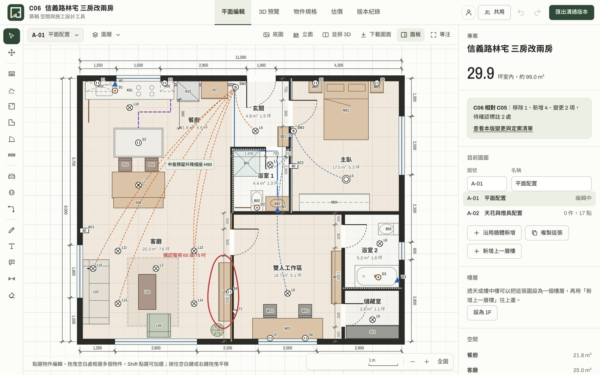
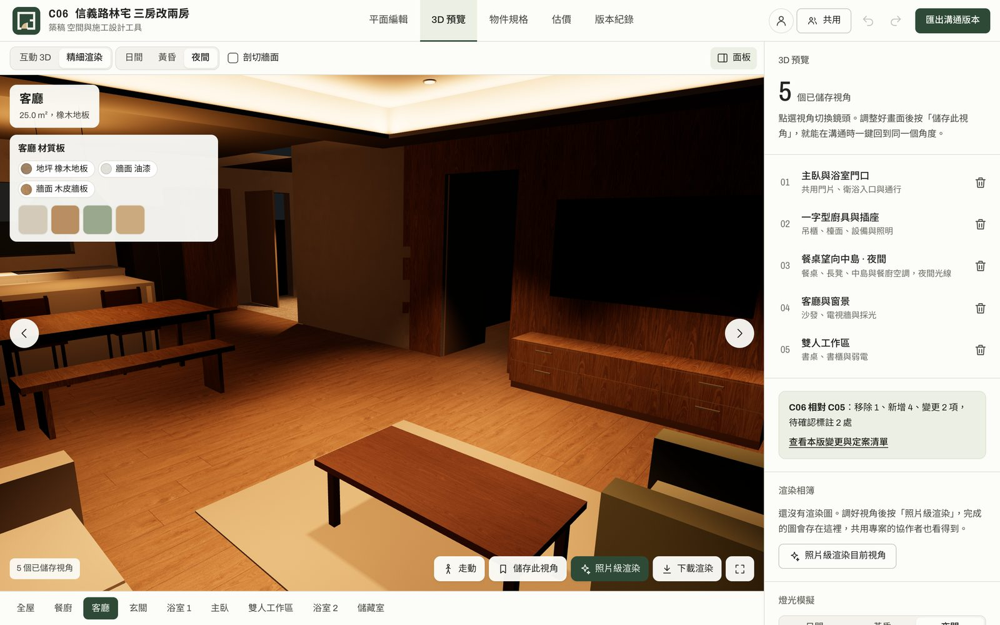
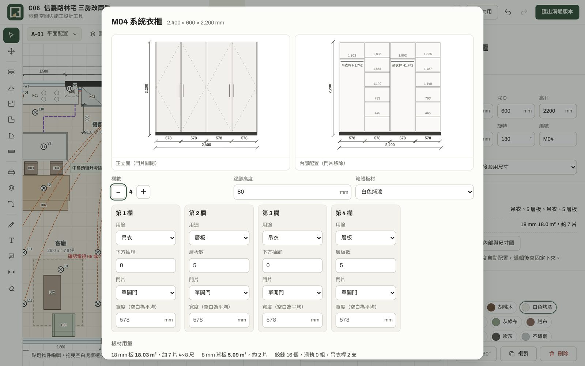
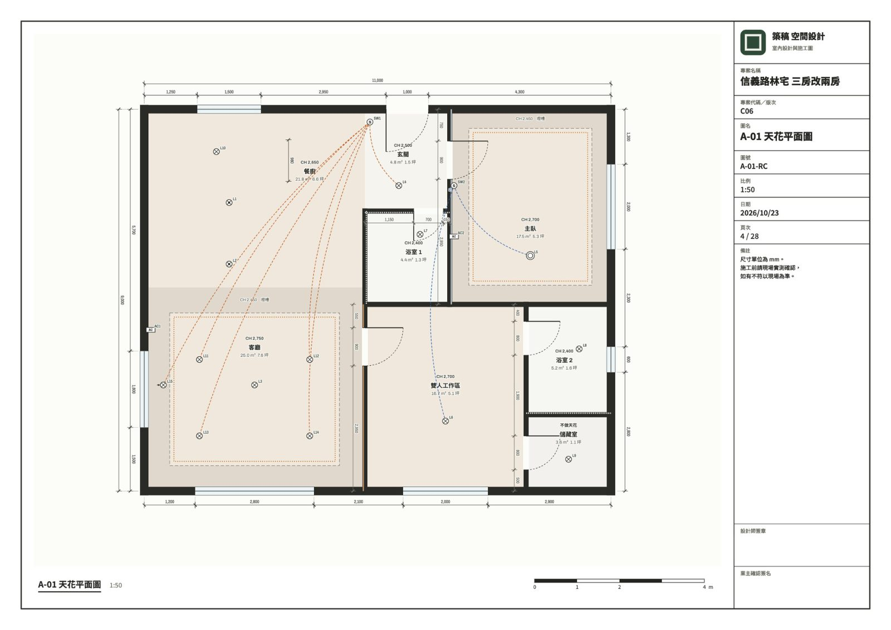

<p align="center">
  
</p>

<p align="center"><b>從格局草圖到施工估價，一個網頁完成。</b><br>給室內設計師與屋主的瀏覽器設計工具：畫平面、擺家具、看 3D、出施工圖、算估價，還能多人即時協作。</p>

<p align="center">
  <a href="https://zhugao-design.web.app"><b>立即使用 →</b></a>
  ·
  <a href="https://zhugao-design.web.app/privacy">隱私權政策</a>
  ·
  <a href="https://zhugao-design.web.app/terms">使用條款</a>
</p>

<p align="center">
  
</p>

不用安裝，手機、平板、電腦都能開。不登入也能用，專案會先存在瀏覽器裡；登入後專案會自動存到你的帳號，換裝置也能接著做。專案名稱下方隨時標示這份專案存在哪裡：只在這台裝置、已存到帳號，或是共用專案。

## 功能

<table>
<tr>
<td width="50%"></td>
<td width="50%"></td>
</tr>
<tr>
<td><b>3D 與燈光</b>：真實照片材質、日間／黃昏／夜間、依空間或開關調光</td>
<td><b>系統櫃</b>：吊衣、層板、抽屜、開放格配置，立面圖與裁切清單</td>
</tr>
</table>

### 平面繪圖

- 畫牆、房間（矩形與多邊形）、弧形牆（可開門窗）、門窗，牆角自動吸附與對齊。
- **草圖描牆**：像在紙上一樣隨手畫，放開後自動拉直、對齊直角、接上既有牆角，畫回起點就成為房間。支援 Apple Pencil 的筆壓，手指可以平移縮放，也不怕手掌誤觸。
- 家具庫、水電點位、管線、手繪標記、文字、尺寸線與留言；多選對齊、圖層鎖定。
- 匯入建商平面圖照片描圖，或匯入 iOS 掃描 App 用 LiDAR 掃好的房間。
- **與 AutoCAD 互通**：匯出分圖層的 DXF（AutoCAD 可再另存成 DWG）；匯入建築師給的 DXF 當底圖，牆角會吸附 CAD 線條，成對的牆線可以一鍵轉成牆體。
- 多張圖面與多樓層：可以新增上一層樓並放置直梯或 U 型樓梯，上層會自動標出梯井開口，3D 能把各樓層疊起來看。

### 3D、材質與燈光

- 即時 3D 預覽，可以存視角，也能以第一人稱走動。
- 木地板、磁磚、石材、木皮、布料等材質都使用真實照片（Poly Haven CC0），依實際尺寸鋪貼。另有系統板色號，也能上傳廠商色樣建立自訂材質。
- 燈具分為筒燈、投射燈、吸頂燈、吊燈、壁燈與間接燈條，可以設定光通量、色溫與調光。燈光會真的照亮 3D 場景，平面上也有工作面照度分析。
- 天花板設計：平釘、四周降板、間接燈槽與不做天花，3D 與平面都會呈現。
- **照片級渲染**：在瀏覽器裡以路徑追蹤計算光線反彈與柔和陰影，快速預覽約 10 秒、提案品質約 1 分鐘，可以在背景渲染，完成的圖會存進專案的雲端渲染相簿。

### 施工圖與估價



- 出圖套組 PDF 有 A3／A4 圖框與正確比例尺，可以選擇要放入的內容：
  - 圖例與符號說明
  - 平面圖（可加自動尺寸標註）
  - 天花平面圖（含開關迴路）
  - 立面圖（每面有櫃體或門窗的牆）
  - 剖面圖（在平面上畫剖面線，切過牆、門窗、天花高低差與樓板）
  - 地坪分割圖（磁磚或木地板排版，附整片與切片數量）
  - 大樣圖（天花降板與燈槽、地坪與踢腳收邊）
  - 系統櫃詳圖與板材裁切清單
  - 效果圖
  - 物件規格表、估價單、工程進度表
- 開關迴路：開關連結受控燈具，同一盞燈接兩個開關就是雙切。
- 估價依圖面自動算出地坪、牆面、天花、木作、系統櫃五金、水電與燈具的數量，單價可以修改。
- 版本紀錄會自動整理每一版新增、變更和移除的項目。

### 工程管理

- 依圖面自動排出施工順序與工期（拆除、水電、泥作、木作、油漆、地坪、系統櫃、燈具、驗收），可以調整工期與前置工項，週日是否施工可切換。
- 每個工項可以指派工班與電話，現場用手機逐項勾選驗收並拍照存證。
- 依估價總額設定分期請款，標示收款狀態，一鍵產生請款單 PDF。

### 協作與帳號

- Google 或 Email 連結登入，專案自動存到帳號，離線時先存在裝置上，恢復連線後補上；其他裝置改過的較新版本會在首頁提示。
- 加入的共用專案也記在帳號裡，換裝置登入就找得到。
- 共用專案可以設定擁有者、可編輯、只能留言、只能檢視四種角色，邀請連結隨時可以撤銷。
- 多人即時同步，看得到誰在線上、誰改了什麼，並能在圖面上留言討論。

## 技術架構

沒有建置流程，`public/` 的內容直接部署成靜態網站。

| 項目 | 使用的技術 |
| --- | --- |
| 介面與平面繪圖 | 原生 JavaScript（ES Module）與 Canvas 2D，主程式在 `public/app.js` |
| 3D | [three.js](https://threejs.org) r160 |
| 照片級渲染 | [three-gpu-pathtracer](https://github.com/gkjohnson/three-gpu-pathtracer) 0.0.23，打包在 `public/vendor/pathtracer.js` |
| PDF | [jsPDF](https://github.com/parallax/jsPDF) 2.5.1 |
| 雲端 | Firebase Hosting、Cloud Firestore（台灣 asia-east1）、Firebase Authentication |
| iOS 掃描 | SwiftUI 與 Apple RoomPlan，在 `ios/ZhugaoScan` |

## 專案結構

```
public/                網站本體，直接部署
  index.html           頁面結構
  app.js               App 主程式：繪圖、3D、估價、出圖、協作
  app.css              樣式
  lib/dxf.js           DXF 讀寫與牆線辨識
  lib/pm.js            工期排程與請款計算
  privacy.html         隱私權政策
  terms.html           使用條款
  tex/                 材質照片（Poly Haven CC0，已壓縮）
  vendor/              打包好的路徑追蹤元件
firestore.rules        資料庫權限規則（角色、邀請、錯誤回報）
firebase.json          Hosting 設定
scripts/errors.py      讀取並清理錯誤回報
ios/ZhugaoScan/        iPhone／iPad LiDAR 掃描 App
brand/                 Logo 與社群分享圖的原始檔
docs/screenshots/      README 用的截圖
```

## 本機開發

```bash
python3 -m http.server 5178 --directory public
```

打開 <http://localhost:5178>。本機版本會連到同一個 Firebase 專案，登入、共用和雲端備份都能直接測試。

## 部署

需要 [Firebase CLI](https://firebase.google.com/docs/cli) 與專案權限：

```bash
firebase deploy --only hosting,firestore:rules --project zhugao-design
```

## 錯誤監控

網站發生錯誤時，會把錯誤訊息、發生位置與瀏覽器版本寫入 Firestore 的 `errlogs`。回報不包含任何專案內容，瀏覽器端只能寫入、不能讀取。查看最近 7 天的錯誤：

```bash
python3 scripts/errors.py
```

腳本使用 `gcloud` 的登入身分，每次執行都會刪除超過 30 天的紀錄。隱私權政策承諾最多保留 30 天，而 Firestore 的自動過期功能需要付費方案，所以請至少每個月執行一次。

## iOS 掃描 App

`ios/ZhugaoScan` 用 LiDAR 與 RoomPlan 掃描房間，匯出 `.zhugao-scan.json` 後，可以在網站「匯入 iPhone 掃描」變成平面圖。編譯與安裝方式見 [ios/ZhugaoScan/README.md](ios/ZhugaoScan/README.md)。

## 素材與第三方授權

- 材質照片：[Poly Haven](https://polyhaven.com)，CC0
- three.js、three-gpu-pathtracer、three-mesh-bvh、jsPDF：MIT License
- 字型：Archivo、Noto Sans TC（Google Fonts，SIL Open Font License）

## 授權

尚未指定開源授權，保留所有權利。
